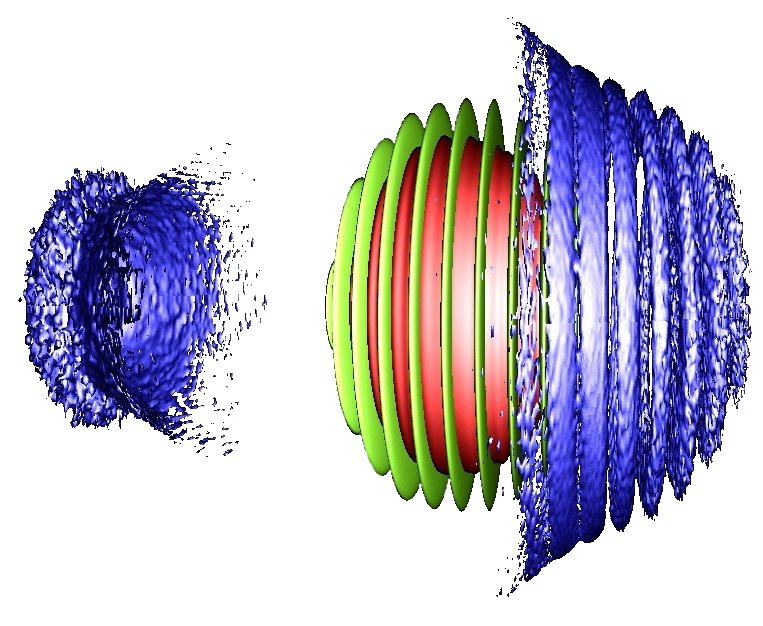

In Situ Animation of Accelerated Computations
=====================================================

About ISAAC
-----------

Nowadays, many computationally intensive codes, such as those used for physics
or biology simulations, are run on GPU-accelerated hardware. On large computing
clusters, this hardware is distributed across multiple nodes, which communicate
with each other via Message Passing Interface (MPI).
The goal of ISAAC is to visualize this data without the need for expensive copy
processes between accelerator and host. This allows ISAAC to fully take advantage
of the high computation speed of these accelerators.

ISAAC consists of three parts: The server, the in-situ library, and the client.

Simulation code just has to add some calls and settings to the **in-situ
template library**. After that, the **server** will notice when a simulation
is running and give the user some options to observe the computations
_on the fly_ via a **client**. The client is able to show the transferred
stream and meta data. It is also possible to send meta data back to the
simulation, e.g., to restart it with improved settings. Multiple clients can
connect to the same server and observe the streamed visualizations.

Installing requirements, building and using in own application
--------------------------------------------------------------

Please see in [INSTALL.md](./INSTALL.md) for installing, building and
using ISAAC and its dependencies.
If you need to install ISAAC on a server not accessible from the outside,
you need to [tunnel the connections](./TUNNEL.md) of the clients.
A more detailed __documentation__ about using ISAAC __can be
[found here](https://computationalradiationphysics.github.io/isaac)__ (_currently
outdated_).

Client
------

A reference HTML5 client is provided here, but needs to be adapted to specific
simulations.
Inside the client directory, the HTML client `visualisation.html` can be found.

It lets you connect to your visualizations directly from your web browser and
allows to change settings and steer the visualization. For visualizations of
__[PIConGPU](https://github.com/ComputationalRadiationPhysics/picongpu)__
with ISAAC enabled, it will also display meta data like the cell count or 
current time step.

As an alternative, a Python client for Jupyter Notebooks is also in development 
and can be found __[here](https://github.com/ComputationalRadiationPhysics/isaac-python)__.

Licensing
---------

ISAAC is licensed under the LGPLv3.

