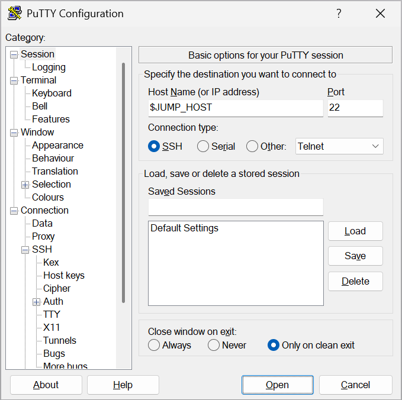
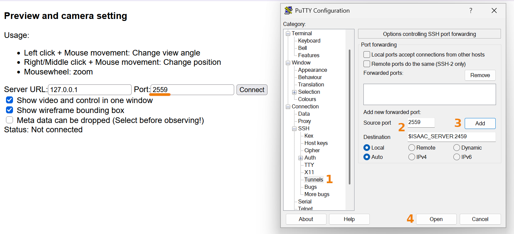
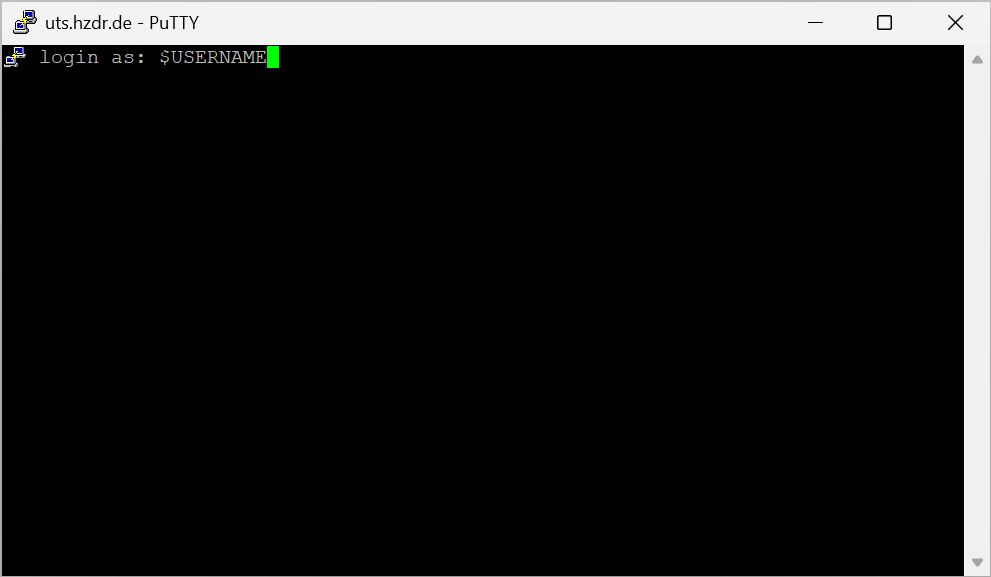

ISAAC Tunnel Guide
==================

The idea behind ISAAC is to install the server a system, which
should be connectable both from the in-situ visualization running on
computation nodes on a HPC cluster, as well as from the clients connecting from
workstations in the local network or over the internet.

A simple solution is to run the ISAAC server on the head node of the cluster. 
However, as most head nodes are not accessible from the outside (on purpose),
this approach needs tunneling for the clients via a jump host, which
will be explained for ISAAC here.

Tunneling over SSH
==================

Regardless of whether a Unix-like OS (Linux and MacOS) or Windows is used, in both
cases, SSH is used for tunneling the connection. This has three main reasons:

* SSH is very easy to use and to install on both systems.
* It provides an user based security layer. Only users available on the
  head node are able to connect to the server.
* The whole communication is encrypted.

This explanation uses a different port than the default ISAAC port in
the HTML5 client (2459), to not collide with other SSH-sessions tunneling
ISAAC or even another ISAAC server instance running on the jump host
itself. So, in the HTML client, the port needs to be changed. In this
explanation, always the local port 2559 is used instead of port 2459.

Tunneling on Linux, Mac and modern Windows
==========================================

MacOS, recent Windows versions, and most (if not all) Linux distributions should
have the needed SSH client already installed. All you need to do is to open a
shell / terminal and to launch ssh with these parameters:

* `ssh $USERNAME@$JUMP_HOST -L 2559:$ISAAC_SERVER:2459`

This opens a shell on the jump host, which will listen in the background
on port 2559 and forward any communication on it to `$ISAAC_SERVER`
on port 2459. `$USERNAME` is your username on the jump host, `$JUMP_HOST` the
jump host used to access the server, and `$ISAAC_SERVER` the system in the jump
hosts network on which ISAAC runs. This may be your head node, but also a
dedicated ISAAC server on a compute node (see below).
For the HZDR and a head node on its ROSI cluster, the command would be, for 
example:

* `ssh mustermann42@uts.hzdr.de -L 2559:rosi5:2459`

After this, the HTML client can connect to localhost on port 2559 (see the
left part of the second PuTTY screenshot), which will then be forwarded
to `$ISAAC_SERVER` over the `$JUMP_HOST`.

If the ISAAC server runs on a compute node, which can only be accessed from the
head node of the cluster, which itself is only accessible inside a local network
via a jump host, you may need to make multiple proxy jumps from your machine to 
the client on the compute node.
For this, the `-J` flag can be used, which takes a chain of multiple jump hosts
through which the connection is tunneled.
For a CPU node (here, cro001 as an example) on the ROSI cluster, this would look
like:

* `ssh -J mustermann42@uts.hzdr.de,mustermann42@rosi5 -L 2559:localhost:2459 mustermann42@cro001`

Legacy tunneling via PuTTY (Pre Windows 10 1803)
=================================================

Unlike most Linux distributions, Windows used to have not many useful programs
installed by default. So, for the SSH tunneling on older Windows versions, an
SSH client is needed.
I recommend the free software [PuTTY](https://www.chiark.greenend.org.uk/~sgtatham/putty/)
for this.

First, you need to enter the URL of the jump host, called `$JUMP_HOST`
in this screenshot:

Afterwards, you need to click Connection -> SSH -> Tunnels in the left menu
to get to this subwindow:

In this screenshot, you also see the client with the changed (!) port in the
background. Enter the source port and the destination into PuTTY, as seen in the 
picture.
Of course, `$ISAAC_SERVER` needs to be changed to the address of the system 
running the ISAAC server right now. Then, click "Add" to enable the tunneling,
and afterwards, "Open" to connect to the jump host. The window will close, and
a command line prompt will appear, asking for your username:

Now, enter here your username of the jump host, press enter, enter the
password of your user, and press enter again. Now, you are connected to
the jump host via SSH, and if you connect to localhost on port 2559 (as seen in
the second image), your connection will be forwarded to `$ISAAC_SERVER`
on port 2459.

Finishing the tunneling
=======================
If you close the connection to the jump host (at best with Ctrl+D), the tunnel 
to the ISAAC server will be closed, too. However, if ssh does not return and is 
stuck on logout, there might still be clients that are connected to the server.
In that case, the clients need to be disconnected, so the tunnel can close.
Alternatively, Ctrl+C can be used to cancel the connection.
